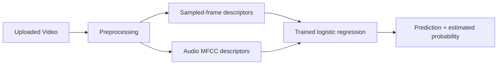

# Multimodal Deepfake Detection System Using Deep Learning

This project is a beginner-friendly research prototype for studying manipulated media with visual and audio signals. The Streamlit application provides video upload, preview, sampled-frame inspection, audio preview using PyAV's bundled FFmpeg libraries, a trainable visual/audio feature baseline, and downloadable analysis reports. The baseline must first be trained on suitable labeled videos; it is a research prototype, not a forensic detector.

## Overview

The metadata and split utilities validate media and conservatively infer labels only from exact recognized folder names. After a baseline checkpoint is trained, uploads are scored using sampled-frame visual statistics and audio MFCC statistics. A score is meaningful only to the extent that the model was trained and validated on relevant, licensed data; it is not a guarantee of authenticity or manipulation.

## Architecture



## Repository structure

```text
multimodal-deepfake-detection/
├── app.py
├── README.md
├── requirements.txt
├── config.yaml
├── .gitignore
├── .streamlit/
│   └── config.toml
├── inspect_dataset.py
├── download_video_dataset.py
├── build_metadata.py
├── split_dataset.py
├── src/
│   ├── __init__.py
│   ├── config.py
│   └── utils.py
├── preprocessing/
│   ├── extract_frames.py
│   ├── extract_audio.py
│   ├── extract_faces.py
│   └── audio_features.py
├── models/
│   ├── visual_model.py
│   ├── audio_model.py
│   ├── fusion_model.py
│   └── synchronization_model.py
├── training/
│   ├── train_detector.py
│   ├── train_visual.py
│   ├── train_audio.py
│   └── train_fusion.py
├── evaluation/
│   ├── metrics.py
│   ├── evaluate.py
│   └── plot_results.py
├── inference/
│   └── predict.py
├── notebooks/
├── tests/
├── data/
│   ├── raw/
│   ├── processed/
│   ├── metadata/
│   ├── models/
│   └── reports/
└── .venv/
```

## Prerequisites

- Python 3.11
- FFmpeg executable installed and available on `PATH` only for the standalone `preprocessing/extract_audio.py` command; the Streamlit app uses PyAV's bundled libraries
- Optional: CUDA-enabled GPU for faster training

## Windows setup

### Create and activate a virtual environment

```powershell
cd "C:\path\to\project"
python -m venv .venv
.\.venv\Scripts\Activate.ps1
```

### Install dependencies

```powershell
python -m pip install --upgrade pip
python -m pip install -r requirements.txt
```

The pinned PyTorch wheels work on CPU. For an NVIDIA GPU, install the matching PyTorch/TorchVision CUDA build using the current command on the official [PyTorch installation selector](https://pytorch.org/get-started/locally/) instead of the two pinned PyTorch lines, then install the remaining requirements. The handcrafted-feature baseline itself runs on CPU.

Install FFmpeg on Windows, for example:

```powershell
winget install Gyan.FFmpeg
ffmpeg -version
```

## Dataset access instructions

FakeAVCeleb was suggested as a research dataset. Before obtaining or using it, review its official documentation and license directly; this project does not download, redistribute, or claim support for a particular FakeAVCeleb directory schema. The metadata builder is generic: it only identifies labels when an exact ancestor folder is named `real`, `original`, `authentic`, `bonafide`, `fake`, `manipulated`, `deepfake`, or `synthetic`. All other labels are `unknown` and must be verified against documented metadata.

### Optional experimental dataset

The downloader can fetch [`angads24/deepfake-video`](https://huggingface.co/datasets/angads24/deepfake-video), pinned to a repository revision and limited to its `dataset/real/` and `dataset/fake/` videos. The repository declares CC BY-SA 4.0, which requires attribution and share-alike for adaptations. Its dataset card does not document source-media provenance or how labels were assigned, so this data and any results from it are experimental only; verify that the license covers the underlying videos before redistribution or other use. The download is several gigabytes and requires an explicit acknowledgement:

```powershell
python download_video_dataset.py --accept-cc-by-sa-and-provenance-risk
```

The downloader resumes an interrupted transfer when rerun. It writes under ignored `data/raw/` storage and does not commit video data to the project.

For this dataset only, the metadata builder groups files sharing the leading numeric filename token as a `source_id`. This is a conservative split heuristic, not a verified identity mapping: the dataset does not document the filename schema. Do not treat the resulting source-disjoint metrics as identity-disjoint or as evidence of generalization. The experiment used `--seed 360` because it produced near-target 60/20/20 row counts while retaining both classes in every partition.

All 400 downloaded videos decoded, but none contained an audio stream. The resulting checkpoint is therefore visual-only; uploaded audio is ignored and the app warns about this. On the fixed 77-video test split, the baseline measured 59.7% accuracy, 59.7% F1, and 0.629 ROC-AUC. These preliminary results are weak and must not be interpreted as reliable deepfake detection.

### Recommended dataset layout

```text
data/raw/
├── real/
│   ├── video_001.mp4
│   └── ...
├── fake/
│   ├── video_010.mp4
│   └── ...
└── metadata/
    └── README.txt
```

## Preprocessing commands

```powershell
python inspect_dataset.py --dataset-dir data/raw
python build_metadata.py --raw-dir data/raw --output data/metadata/metadata.csv
python split_dataset.py --metadata data/metadata/metadata.csv --output-dir data/processed
```

The metadata CSV includes media type, file size, SHA-256, validity, duplicate status, and notes. Invalid, duplicate, and unknown-label records are not used when creating splits. The splitter groups by `source_id` so identical source IDs do not cross splits and requires both labels in every split. For video detection, each labeled media row must point to a video file. Check the generated CSV and split class counts before proceeding.

## Training commands

Train the CPU-compatible handcrafted visual/audio baseline using only the training split. The validation split must be source-disjoint; the trainer checks for overlap and reports measured validation metrics. It does not use the test split for model selection.

```powershell
python -m training.train_detector `
  --train-metadata data/processed/train.csv `
  --validation-metadata data/processed/val.csv `
  --output data/models/multimodal_baseline.joblib
```

Training extracts sampled-frame color/texture/face-presence summaries and audio MFCC/acoustic summaries, then fits a standard-scaled logistic regression. Missing audio is recorded as an explicit modality flag; no fake audio score is substituted. This feature baseline is intentionally simple and may not generalize to unseen datasets or manipulation methods. The older `train_visual.py`, `train_audio.py`, and `train_fusion.py` commands remain disabled because those deep neural training flows are not implemented.

## Evaluation commands

```powershell
python evaluation/evaluate.py --metadata data/processed/test.csv --predictions data/reports/test_predictions.csv --output data/reports/evaluation_report.json
```

Create the predictions CSV with your validated inference runner before evaluating; the project does not generate benchmark predictions for you.

## Application launch

```powershell
python -m streamlit run app.py
```

The app accepts MP4, MOV, AVI, and MKV files up to 200 MB. It keeps the uploaded file and extracted audio in a temporary directory, removes those files after analysis, and provides JSON/CSV reports. Audio preview and model features use PyAV, installed with the requirements, and do not need a separately installed FFmpeg executable. If no trained baseline checkpoint exists, the app displays the exact data preparation and training commands instead of returning a prediction. If the default port is occupied, start it on another port:

```powershell
python -m streamlit run app.py --server.port 8502
```

### Model scope and interpretation

The baseline reports a classifier prediction, estimated fake probability, confidence, and modalities used after actual training. It does not establish that a video is authentic or manipulated. It is a lightweight educational baseline; robust deepfake detection requires research-grade datasets, careful identity/source-disjoint validation, external testing, fairness review, and trained deep models. Audio-video synchronization scoring is not implemented and is not included.

## Expected outputs

- `data/metadata/metadata.csv`
- `data/processed/*` split files
- `data/reports/*.json` and `.csv` reports
- Streamlit video/frame/audio inspection and JSON/CSV reports
- `data/models/multimodal_baseline.joblib` after successful training
- Measured validation metrics in the training command output

## Troubleshooting

- If the standalone audio extraction command reports that FFmpeg is missing, install it from https://www.ffmpeg.org/download.html and confirm `ffmpeg` is on `PATH`. The Streamlit app itself uses PyAV for audio preview.
- If port 8501 is occupied, start Streamlit on another port such as 8502.
- If the baseline checkpoint is missing, prepare verified labeled data, create source-grouped splits, and run `python -m training.train_detector`.
- If training reports only one class or no valid videos, inspect the folder labels and metadata CSV; both real and fake examples are required.
- If a dataset is partially corrupt, the metadata builder flags it instead of failing the whole run.
- If one class is missing in validation data, evaluation functions gracefully handle this case.
- Run the tests with `python -m pytest -q`.

## Limitations and ethical considerations

This prototype is intended for research and educational use. It should not be used to misclassify real individuals or to produce harmful research outputs. Detection confidence does not guarantee correctness. The system should be evaluated with careful benchmark reporting and fairness checks.

## References and licenses

- FakeAVCeleb dataset documentation: consult the official project page and license terms before downloading or redistributing it.
- OpenCV, PyTorch, Transformers, scikit-learn, Librosa, Streamlit
- Each model and dataset should be used according to its license terms.

## Notes

The baseline is an actual trained classifier when produced from real labeled input data, but its predictions are only as reliable as that data and evaluation. It is not a substitute for a fully validated production or forensic detector.
